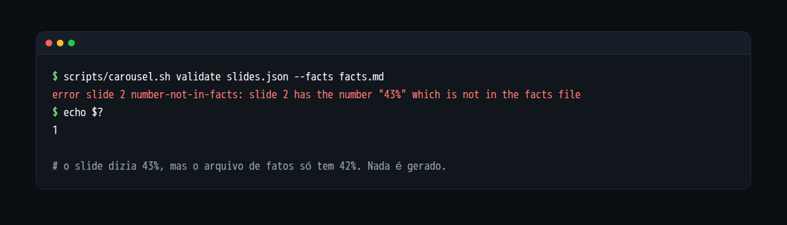

# sourced-carousel

[English](README.en.md) | Português


Gera um carrossel de LinkedIn em PDF e PNG a partir de um `slides.json`, e reprova o carrossel se algum número não estiver no arquivo de fatos que você forneceu. Roda em um container sem rede, sem navegador. Também é uma skill do Claude Code (veja [SKILL.md](SKILL.md)).

## Por que existe

Um carrossel de dados costuma ter números que viram "verdade" só porque estão numa imagem bonita. Este projeto cria uma trava simples: cada número dos slides precisa aparecer, escrito do mesmo jeito, em um arquivo de fatos com o trecho literal da fonte e o link. Se não aparecer, o PDF não é gerado.

Também reprova travessão, meia-risca e seta nos textos, e limita o tamanho do texto de cada slide.

## Instalação

Precisa de Docker. Nada é instalado no seu sistema: tudo roda em container.

```
git clone https://github.com/lpalvess/sourced-carousel.git
cd sourced-carousel
scripts/carousel.sh setup      # instala as dependências no container; único passo com rede
scripts/carousel.sh selftest   # prova que o container não tem rede e não escreve fora de out
```

### Usar como skill do Claude Code

A skill roda os scripts do próprio repositório, então abra o Claude Code dentro da pasta clonada e instale o `SKILL.md` como skill do projeto:

```
mkdir -p .claude/skills/sourced-carousel
cp SKILL.md .claude/skills/sourced-carousel/SKILL.md
```

Depois peça, por exemplo: "faça um carrossel deste post usando os fatos de fatos.md". A skill propõe o plano dos slides, espera sua aprovação, valida, gera o PDF em `out/` e nunca publica nada.

## Exemplo completo

Os arquivos em `examples/` são FICTÍCIOS: uma empresa inventada, números inventados e um link de exemplo.

```
scripts/carousel.sh validate examples/slides.json --facts examples/facts.md
scripts/carousel.sh render   examples/slides.json --facts examples/facts.md --out out
```

O `validate` não imprime nada e sai com 0 quando não há erro nem aviso. O `render` valida primeiro, imprime `slide 1/6` até `slide 6/6` e escreve em `out/` seis PNGs (`01-hook.png`, `02-number.png`, e assim por diante) e `carousel.pdf` com seis páginas.

Se um número do slide não estiver nos fatos (por exemplo, trocar `42%` por `43%`), o resultado é:

```
error slide 2 number-not-in-facts: slide 2 has the number "43%" which is not in the facts file
```

e o código de saída é 1.



O mesmo exemplo no tema claro e no formato retrato (`"meta": { "theme": "light", "format": "linkedin-portrait" }`):


As imagens acima são a saída real da ferramenta sobre `examples/`, montadas numa página e capturadas com Playwright em um contêiner sem rede. O Playwright não faz parte do projeto.

### O arquivo de fatos

Qualquer texto serve. O formato recomendado é uma linha por fato, com número, contexto, trecho literal e link:

```
- 42% | redução do tempo gasto em reuniões de status | "o tempo gasto caiu 42% no piloto" | https://example.com/relatorio
```

O validador procura cada número do slide como texto exato dentro desse arquivo.

## Tipos de slide

O `slides.json` tem `meta` (opcional) e `slides`, de 3 a 10. Todo slide aceita `source` (rodapé, até 80 caracteres) e `highlight` (1 ou 2 palavras do próprio slide, na cor de destaque).

| type | Campos obrigatórios | Observações |
| ---- | ------------------- | ----------- |
| `hook` | `text` | Até 3 linhas. Abertura. |
| `text` | `title`, `text` | `text` com até 40 palavras. |
| `number` | `value`, `label` | `value` é o número grande, como `42%`. |
| `list` | `title`, `items` | 1 a 6 itens. |
| `quote` | `text`, `author` | Citação. |
| `cta` | `text`, `handle` | Fechamento. |

`meta` aceita `theme` (`dark`, padrão, ou `light`), `format` (`linkedin-square` 1080x1080, padrão, ou `linkedin-portrait` 1080x1350) e `accent` (cor `#RRGGBB`).

## Regras do validador

Cada achado sai como `<severity> slide <N> <rule-id>: <mensagem>`.

| ID | Severidade | O que reprova |
| -- | ---------- | ------------- |
| `schema-invalid` | erro | JSON inválido, estrutura fora do schema ou `meta` inválido. |
| `type-unknown` | erro | Slide sem `type` ou com tipo desconhecido. |
| `field-missing` | erro | Falta campo obrigatório do tipo, ou `items` fora de 1 a 6. |
| `slide-count` | erro | Menos de 3 ou mais de 10 slides. |
| `too-many-words` | erro | `text` de um slide `text` com mais de 40 palavras. |
| `hook-too-long` | erro | `hook` com mais de 3 linhas. |
| `highlight-invalid` | erro | `highlight` vazio, com mais de 2 palavras ou que não aparece no slide. |
| `source-too-long` | erro | `source` com mais de 80 caracteres. |
| `forbidden-char` | erro | Travessão longo, meia-risca, outros traços (U+2012, U+2015, U+FE58, U+FF0D), qualquer seta dos blocos de setas do Unicode, e as sequências `->`, `=>` e `<-`, em qualquer texto. Hífen simples e sinal de menos (U+2212) são permitidos. |
| `number-not-in-facts` | erro | Número fora de `source` que não está no arquivo de fatos. O número é comparado inteiro e como escrito: `42%` não está em `142%`, nem em `42`; o sinal e a unidade (`%`, `K`, `mil`, `M`) fazem parte do número. |
| `non-ascii-digit` | erro | Dígitos que não são 0 a 9 (por exemplo árabe-índicos), que não dá para comparar com o arquivo de fatos. Dígitos de largura total são convertidos e aceitos. |
| `structure` | aviso | O primeiro slide não é `hook` ou o último não é `cta`. |
| `facts-skipped` | aviso | Há número mas `--facts` não foi informado. |

## Códigos de saída

| Código | Significado |
| ------ | ----------- |
| 0 | Sem erros (avisos não contam). |
| 1 | Erro de validação. |
| 2 | Argumentos errados, arquivo ilegível ou dependências não instaladas. |
| 3 | Falha ao gerar (render, pdf ou escrita). Nenhum `carousel.pdf` fica no disco. |
| 4 | O container não pôde ser iniciado (por exemplo, Docker ausente). |

## Segurança

O que o projeto garante, por construção:

- Validar e gerar rodam em container com `--network none`: sem rede em tempo de execução, sem telemetria.
- O código é montado somente leitura, o sistema de arquivos raiz é somente leitura, sem capabilities do Linux, e só o diretório de saída é gravável.
- Não usa navegador. O desenho é feito com Satori e resvg-wasm.
- A entrada é um JSON lido como dado, nunca executado, e todo texto é desenhado como texto.
- 2 dependências diretas de runtime (`satori` e `@resvg/resvg-wasm`), com versão exata. A instalação usa lockfile congelado e scripts de instalação desligados. O detalhe está em [docs/dependencies.md](docs/dependencies.md).
- A imagem base do container é fixada por digest.

O que o projeto NÃO garante:

- Que o número esteja certo na fonte. O validador só confirma que o número veio do arquivo de fatos. Quem confere o trecho contra a fonte é você.
- Que o texto do PDF seja selecionável. As páginas viram imagem.
- A segurança do Docker em si. O isolamento depende do Docker e do seu sistema.

Para reportar uma vulnerabilidade, veja [SECURITY.md](SECURITY.md).

## Limitações conhecidas

- O texto no PDF vira imagem e não é selecionável.
- O ajuste de texto é uma estimativa conservadora. Se o texto não couber nem no tamanho mínimo, o render falha com `text-overflow`.
- Um gancho de 3 linhas pode quebrar em mais linhas ao renderizar. Confira os PNGs.
- Só dois formatos (LinkedIn quadrado e retrato) e dois temas.
- O validador só confere números escritos com dígitos. Um número por extenso ("trinta mil") não é conferido: escreva sempre com dígitos.
- Só são conferidas as unidades da lista (`%`, `x`, `×`, `K`, `k`, `M`, `B`, `mil`, `mi`, `bi`, `milhão`, `milhões`, `bilhão`, `bilhões`, `thousand`, `million`, `billion`). Outra unidade (`5 pp`, `2 trilhões`, `15 por cento`) não é conferida: escreva o número com uma unidade da lista ou sem unidade.
- Milhar com espaço (`1 000 000`) e notação científica (`1e3`) não são conferidos como um número só.
- Dígitos colados a letras (`Q4`, `10h30`, `ISO27001`) não são conferidos.
- O validador confere que o número veio do arquivo de fatos, não que o trecho está certo na fonte. Isso é com você.
- O teste estático de segurança em `tests/security-static.test.ts` é uma heurística de padrões em `src/`. A defesa real é o container sem rede.

## O que este projeto não faz

- Não escreve o texto do post.
- Não publica em nenhuma rede social.
- Não tem editor visual.
- Não gera imagens com IA e não coloca imagens nos slides.

## Projetos parecidos

Outros projetos que também geram carrosséis e podem servir melhor ao seu caso:

- [ContentHub](https://github.com/thallisribeiro/contenthub): gera conteúdo e carrosséis para Instagram.
- [threads-carousel-claude-skill](https://github.com/itchernetski/threads-carousel-claude-skill): skill do Claude Code que transforma posts em carrosséis, com prévia no navegador. Foi a inspiração para este projeto.
- [linkedin-carousel-gen](https://github.com/Slashgear/linkedin-carousel-gen): gera PDFs de carrossel do LinkedIn com Satori e Bun.

## Licença e créditos

- Código sob licença MIT, veja [LICENSE](LICENSE).
- Fonte Inter, licença OFL, veja [THIRD_PARTY_FONTS.md](THIRD_PARTY_FONTS.md).
- Satori e resvg-wasm são MPL-2.0 e usados sem modificação. Veja [docs/dependencies.md](docs/dependencies.md).
